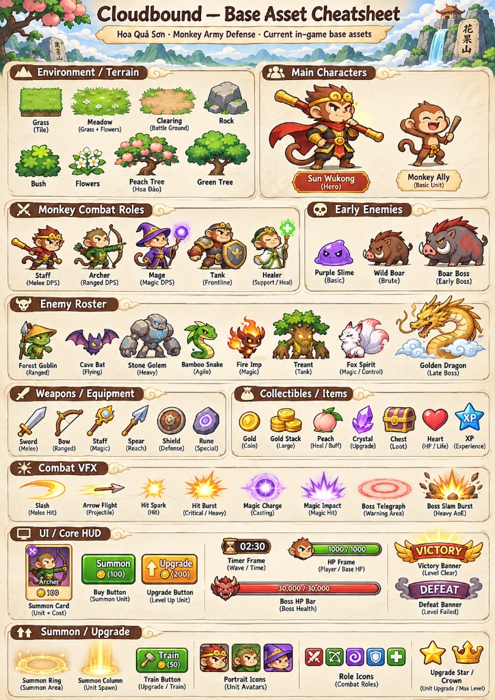

# Cloudbound — Base Asset Cheatsheet (Reference Spec)

> **Reference Image:** [`docs/reference/base-asset-cheatsheet.jpg`](reference/base-asset-cheatsheet.jpg)  
> **Project:** Hoa Quả Sơn · Monkey Army Defense  
> **Purpose:** Chuẩn đối chiếu chính thức cho tạo hình, màu sắc nhận diện, phong cách đồ họa và danh mục base asset của dự án.

---

## Global Art Direction

- **Style:** 2D chibi, nét viền nâu đậm đều và rõ (`thick clean dark-brown outline`), tô bóng cel-shaded gọn, màu sắc tươi ấm, độ tương phản cao để dễ đọc trên nền cỏ xanh.
- **Readability First:** Mỗi class quân, loại quái, vũ khí, item và trạng thái UI phải phân biệt ngay lập tức bằng **silhouette + màu sắc chủ đạo**.

---

## 1. Environment / Terrain

| Asset | Mô tả chuẩn trên Cheatsheet |
| --- | --- |
| **Grass (Tile)** | Ô cỏ xanh tươi phẳng, viền ngọn cỏ nhỏ gọn |
| **Meadow (Grass + Flowers)** | Thảm cỏ xanh điểm hoa trắng/vàng nhỏ |
| **Clearing (Battle Ground)** | Khoảng đất cát vàng ấm có viền cỏ bao quanh |
| **Rock** | Tảng đá xám góc cạnh nhẹ, có bụi cỏ nhỏ ở chân |
| **Bush** | Bụi cây xanh đậm nhiều cụm tròn |
| **Flowers** | Cụm hoa trắng nhụy vàng, lá xanh |
| **Peach Tree (Hoa Đào)** | Cây tán lá xanh đậm **trĩu quả đào hồng** (không phải cây hoa đào hồng toàn tán) |
| **Green Tree** | Cây tán xanh rậm thân nâu |

---

## 2. Main Characters

| Character | Vai trò | Tạo hình chuẩn |
| --- | --- | --- |
| **Sun Wukong** | Hero | Khỉ đội vòng kim cô vàng, **giáp đen viền vàng**, đai đỏ, áo choàng đỏ, cầm gậy Như Ý đỏ-vàng |
| **Monkey Ally** | Basic Unit | Khỉ nâu đơn giản, mặc khố/đai đỏ nhỏ, cầm gậy gỗ mộc |

---

## 3. Monkey Combat Roles (5 Classes)

> Mỗi role có **trang phục, phụ kiện và màu sắc đặc trưng riêng**, không dùng chung một thân khỉ trần.

| Role | Chức năng | Màu chủ đạo | Tạo hình chuẩn |
| --- | --- | --- | --- |
| **Staff** | Melee DPS | Đỏ / Đen / Vàng | Đeo băng đô vàng, mặc giáp/áo tối viền vàng + khăn đỏ, cầm gậy đỏ đầu vàng |
| **Archer** | Ranged DPS | Xanh lá | Mặc áo xanh lá + đai đeo tên nâu, cầm cung gỗ + mũi tên |
| **Mage** | Magic DPS | Tím | Đội mũ phù thủy tím, mặc áo choàng tím, cầm trượng phép phát sáng tím |
| **Tank** | Frontline | Xanh dương / Vàng | Mặc giáp vai + giáp thân kim loại viền vàng, cầm khiên lớn màu vàng-nâu |
| **Healer** | Support / Heal | Xanh lục / Trắng | Đội khăn trắng viền xanh lá, mặc áo trắng-xanh, cầm trượng đầu cỏ bốn lá phát sáng xanh |

---

## 4. Early Enemies

| Enemy | Loại | Tạo hình chuẩn |
| --- | --- | --- |
| **Purple Slime** | Basic | Slime tím bo tròn dễ thương, ánh bóng sáng |
| **Wild Boar** | Brute | Heo rừng nâu, nanh trắng nhỏ |
| **Boar Boss** | Early Boss | Heo rừng lớn **lông xám đen**, bờm đỏ dựng, nanh lớn, có **hoa văn xoáy đỏ** trên thân |

---

## 5. Enemy Roster

| Enemy | Loại | Tạo hình chuẩn |
| --- | --- | --- |
| **Forest Goblin** | Ranged | Goblin da xanh lá, đội nón lá, mặc áo nâu, cầm cung gỗ |
| **Cave Bat** | Flying | Dơi cánh tím đậm, tai lớn, mắt vàng |
| **Stone Golem** | Heavy | Người đá xám nhiều khối, có **ký tự rune phát sáng xanh dương** trên ngực |
| **Bamboo Snake** | Agile | Rắn xanh lá có sọc đốt trúc |
| **Fire Imp** | Magic | Tiểu yêu lửa nhỏ rực cam-đỏ, đầu bốc lửa |
| **Treant** | Tank | Thụ nhân thân cây nâu, tán lá xanh, mắt phát sáng vàng |
| **Fox Spirit** | Magic / Control | Cáo trắng nhiều đuôi đầu lông hồng/đỏ |
| **Golden Dragon** | Late Boss | Rồng phương Đông màu vàng kim **dáng bay uốn lượn uy nghi**, sừng vàng, mây xanh nhạt |

---

## 6. Weapons / Equipment

| Asset | Loại | Mô tả chuẩn |
| --- | --- | --- |
| **Sword** | Melee | Kiếm lưỡi bạc chuôi vàng |
| **Bow** | Ranged | Cung gỗ cong dây căng |
| **Staff** | Magic | Trượng vàng gắn ngọc xanh/vàng |
| **Spear** | Reach | Giáo cán gỗ mũi thép có tua đỏ |
| **Shield** | Defense | Khiên tròn gỗ viền kim loại |
| **Rune** | Special | Đá rune tím khắc biểu tượng xoáy trắng |

---

## 7. Collectibles / Items

| Asset | Công dụng | Mô tả chuẩn |
| --- | --- | --- |
| **Gold** | Coin | Đồng xu vàng đơn |
| **Gold Stack** | Large | Chồng xu vàng lớn |
| **Peach** | Heal / Buff | Quả đào tiên hồng có 2 lá xanh |
| **Crystal** | Upgrade | Tinh thể tím phát sáng |
| **Chest** | Loot | Rương kho báu gỗ tím-nâu viền vàng |
| **Heart** | HP / Life | Trái tim đỏ bóng |
| **XP** | Experience | Ngôi sao xanh dương có chữ `XP` |

---

## 8. Combat VFX

| VFX | Công dụng | Mô tả chuẩn |
| --- | --- | --- |
| **Slash** | Melee Hit | Vệt chém cong màu vàng sáng |
| **Arrow Flight** | Projectile | Mũi tên bay kèm vệt gió trắng |
| **Hit Spark** | Hit | Tia nổ va chạm vàng nhỏ |
| **Hit Burst** | Critical / Heavy | Vụ nổ gai cam-vàng lớn |
| **Magic Charge** | Casting | Vòng tụ phép màu tím có tia sáng |
| **Magic Impact** | Magic Hit | Vụ nổ năng lượng tím |
| **Boss Telegraph** | Warning Area | Vòng tròn đồng tâm đỏ cảnh báo trên mặt đất |
| **Boss Slam Burst** | Heavy AoE | Vụ đập đất tung mảnh đá + sóng xung kích cam-vàng |

---

## 9. UI / Core HUD & Summon / Upgrade

### Core HUD
- **Summon Card (Unit + Cost):** Khung thẻ đứng có nền tím/vàng, **Role Icon ở góc trên trái**, hình unit đầy đủ ở giữa, tên role và giá vàng ở dưới.
- **Buy Button (Summon Unit):** Nút bo tròn màu **xanh lá** (`Summon` + giá xu).
- **Upgrade Button (Level Up Unit):** Nút bo tròn màu **cam** có mũi tên lên (`Upgrade` + giá xu).
- **Timer Frame (Wave / Time):** Khung nâu tối có icon **đồng hồ cát** bên trái + chữ số trắng (`02:30`).
- **HP Frame (Player / Base HP):** Thanh máu xanh lá có **icon đầu khỉ** bên trái.
- **Boss HP Bar (Boss Health):** Thanh máu đỏ dài có **icon đầu quỷ/boss đỏ** bên trái.
- **Victory Banner (Level Clear):** Dải ruy-băng vàng có **đôi cánh vàng** hai bên, chữ `VICTORY` đỏ-cam.
- **Defeat Banner (Level Failed):** Dải ruy-băng xám-tím có cánh xám, chữ `DEFEAT` tím.

### Summon / Upgrade
- **Summon Ring (Summon Area):** Vòng ma pháp phát sáng vàng trên mặt đất.
- **Summon Column (Unit Spawn):** Cột ánh sáng vàng chiếu thẳng xuống khi triệu hồi.
- **Train Button (Upgrade / Train):** Nút xanh lá có icon **búa** + `Train` + giá xu.
- **Portrait Icons (Unit Avatars):** Khung vuông bo góc hiển thị chân dung từng class đúng trang phục (Staff, Archer, Mage...).
- **Role Icons (Combat Roles):** Bộ 5 badge vuông bo góc đồng bộ mã màu:
  - Staff: **Đỏ** (kiếm/vũ khí cận chiến)
  - Archer: **Xanh lá** (cung tên)
  - Mage: **Tím** (xoáy phép)
  - Tank: **Xanh dương** (khiên)
  - Healer: **Xanh lục sáng** (dấu cộng)
- **Upgrade Star / Crown:** Ngôi sao vàng (nâng cấp) & vương miện vàng (Max Level).

---

## Gap Summary vs. Current Assets (2026-11-20)

| Nhóm | Tình trạng hiện tại | Ưu tiên đồng bộ |
| --- | --- | --- |
| **Monkey Combat Roles** | Sprite trong `assets/survivor/combat/` và portrait trong `assets/survivor/summon/` dùng chung mẫu khỉ đeo khăn đỏ, thiếu trang phục riêng theo class | **P0 (Cao nhất)** |
| **Role Icons & Core HUD** | Role icons hiện là vũ khí rời chưa thành bộ badge vuông mã màu; HUD in-game dùng khung phẳng, asset UI cũ theo style lá cây khác cheatsheet | **P1** |
| **Peach Tree** | `assets/survivor/peach_tree.png` đang là cây hoa đào hồng thay vì cây tán xanh quả đào | **P2** |
| **Boar Boss & Sun Wukong** | Boar Boss đang là heo nâu giáp vàng (cần xám-đỏ); Wukong mặc áo vàng (cần giáp đen viền vàng) | **P2** |
| **Golden Dragon** | `assets/survivor/enemies/golden_dragon.png` đang là rồng 4 chân chibi thay vì rồng bay uốn lượn | **P3** |
